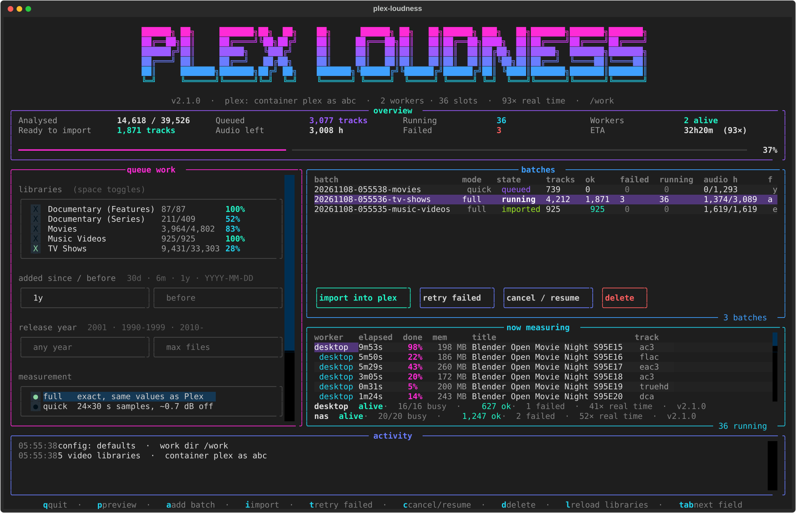

<p align="center">
  <a href="https://github.com/Jarsky/plex-loudness/actions/workflows/ci.yml"></a>
  <a href="LICENSE"></a>
  
  
  
</p>

<p align="center"></p>

Fills in Plex's **video loudness data** — the measurements behind *Normalize Loudness* and
*Boost Dialog* — with ffmpeg, in parallel, on as many machines as you like.

The values are **identical to Plex's own**: Plex measures with ffmpeg's `loudnorm` filter, and
plex-loudness runs the same filter with the same settings and writes the result in exactly the
format Plex stores. In testing, every field of every track compared matched Plex's values, and
100,000 existing database rows were rebuilt byte for byte.



## Why this exists

Since Plex Media Server 1.43.4, Plex can [even out the volume of movies and TV](https://support.plex.tv/articles/audio-track-enhancements-for-video/)
(*Normalize Loudness*, *Boost Dialog*) on supported clients. That needs every audio track to be
analysed first, and Plex's own analysis doesn't scale to a large library:

* **One file at a time.** The analysis is a single background job on the server, using about one
  CPU core. It measures the whole soundtrack at true-peak precision, which runs at a few times real
  time — so a library with tens of thousands of hours of audio takes *months*, however many cores
  the server has.
* **Memory runaways.** On some files (in our case several 4K Dolby Digital+/TrueHD/DTS-HD remuxes) the job
  grows until it hits the container's memory limit and is killed — sometimes taking the Plex server
  process with it. A failed item is retried after every restart, so it can happen again and again.
  Others have reported the same:
  [loudness data generation memory leak](https://forums.plex.tv/t/loudness-data-generation-memory-leak/804550),
  [analyze-loudness runaway memory usage](https://forums.plex.tv/t/plex-media-scanner-analyze-loudness-runaway-memory-usage/712960),
  [memory leaks with "Analyze audio tracks for loudness"](https://forums.plex.tv/t/memory-leaks-when-enable-the-option-of-analyze-audio-tracks-for-loudness/776490).
* **It competes with playback** on the same machine, all day, for as long as the backlog lasts.

plex-loudness does the same measurement outside Plex: with stock ffmpeg (no Plex transcoder, no
EAE audio service), one process per track, spread over every core of every machine you point at
it. Once the backlog is imported, Plex's own analysis can be switched back on to handle new files.

## How it works

```
 ┌──────── controller (where Plex runs) ────────┐          ┌──────── worker(s): NAS, desktop, … ────────┐
 │ TUI / CLI                                     │          │ plex-loudness-worker                        │
 │ • reads the Plex DB: which tracks need data   │  shared  │ • claims tracks from queued batches          │
 │ • queues batches in the shared folder         │  folder  │ • runs ffmpeg loudnorm, one process/track    │
 │ • imports finished results into the Plex DB   │ <──────> │ • writes results and live status             │
 └───────────────────────────────────────────────┘          └──────────────────────────────────────────────┘
```

The **controller** and the **workers** are separate on purpose:

* The controller is light. It only needs to reach the Plex database, so it runs next to Plex.
* Measuring is pure CPU (one core per track). Workers can run **wherever the cores are** — the NAS
  next to the disks, or a much more powerful **desktop** while you're not using it — and as many
  as you like at once. Tracks are claimed atomically, so workers never duplicate work, and a worker
  that disappears has its tracks taken over after 10 minutes.
* Workers never touch the Plex database; they only read media and the shared folder.

### What Plex stores

Per audio stream, in `media_streams.extra_data`, measured with
`loudnorm=I=-16:TP=-1:LRA=9:print_format=json`:

| Plex field | loudnorm value | meaning |
|---|---|---|
| `ln:loudness` | `input_i` | integrated loudness (LUFS) |
| `ln:peak` | `input_tp` | true peak (dBTP) |
| `ln:lra` | `input_lra` | loudness range (LU) |
| `ln:threshold` | `input_thresh` | gating threshold |
| `ln:gainOffset` | `target_offset` | offset after loudnorm's normalisation |
| `ln:loudnessAnalysisVersion` | `0.02` | |

Music libraries use different fields (`ld:*`) and aren't handled — Plex's music analysis copes fine.

## Setup (Docker)

One container, configured in `.env`, in the same style as [media-health](https://github.com/Jarsky/media-health).

```bash
git clone https://github.com/Jarsky/plex-loudness && cd plex-loudness
cp .env.example .env        # set ROLE, WORK_PATH, MEDIA_PATH, PUID/PGID
docker compose up -d --build
docker exec -it plex-loudness plex-loudness     # the TUI   (or ./plex-loudness)
```

`ROLE` decides what the container does:

| ROLE | Where | Needs |
|---|---|---|
| `both` | one machine with Plex and the media | `WORK_PATH`, `MEDIA_PATH`, docker socket |
| `controller` | the machine running Plex | `WORK_PATH`, docker socket |
| `worker` | wherever the CPU is: NAS, desktop, … (any number) | `WORK_PATH`, `MEDIA_PATH`, `PUID`/`PGID` |

* **`WORK_PATH`** is the shared folder. The controller and every worker must see the same folder
  (e.g. a NAS share mounted on each machine).
* The **docker socket** comes from `docker-compose.controller.yml`; `.env.example` sets
  `COMPOSE_FILE` for it. Remove that line on worker-only machines.
* **Auto-detected:** the Plex container (the one with Plex SQLite in it), the database owner, and
  where Plex's folders (`/tv`, `/movies`, …) live under `MEDIA_PATH` — the worker looks for a real
  file, then remembers the mapping. Override with `PLEX_CONTAINER`, `PLEX_USER`, `PATH_MAP`.

### A worker on your desktop

A desktop CPU with 16+ threads can clear a backlog several times faster than a NAS. With Docker
(Docker Desktop on Windows/macOS, or Docker on Linux), mount the NAS shares straight into the
container with the SMB override:

```bash
# .env on the desktop
ROLE=worker
COMPOSE_FILE=docker-compose.yml:docker-compose.cifs.yml
SMB_HOST=nas.local
SMB_MEDIA=media                 # the share holding your library (read-only)
SMB_WORK=share/plex-loudness    # the shared folder the controller uses
SMB_USER=me
SMB_PASSWORD=secret
WORKERS=14                      # leave a couple of threads for yourself
CPUS=14
WORKER_NAME=desktop
```

`docker compose up -d --build`, and the desktop shows up in the controller's worker list within
seconds. Stop it any time with `docker compose stop` — its running tracks are handed back to the
other workers.

Without Docker: `pip install .` plus ffmpeg on the PATH, then `plex-loudness-worker`, with
`WORK_DIR`, `MEDIA_ROOT` (and if needed `PATH_MAP`) as environment variables. This route is
tested on Linux only.

## The TUI

* **queue work** — pick libraries (with how much each already has), optionally a date-added window
  and/or release years and a file limit, choose *full* or *quick*, **preview** (`p`: files, tracks,
  hours, ETA at the current worker speed), **queue batch** (`a`).
* **batches** — progress of each batch; **import into plex** (`i`: shows what it will write and
  asks first), **retry failed** (`t`), **cancel / resume** (`c`), **delete** (`d`).
* **now measuring** — every track being measured on every worker, with progress and memory.
* **overview** — analysed vs total, queued, running, failed, ready to import, speed and ETA.

## Measurement modes

| Mode | Reads | Accuracy (vs full) | CPU |
|---|---|---|---|
| `full` (default) | the whole audio track | **exact** — Plex's own values | 1× |
| `quick` | 24 × 30 s samples | loudness ±0.7 dB on average (worst ~1.7), peaks under-read | ~4× less |
| `sampled` | N × S s samples | worse with fewer samples (5 × 10 s: ±1.3 dB avg, ±3 dB worst) | |

Samples miss the loudest moments, so sampled peaks are almost always too low. `import` skips
sampled results unless you pass `--allow-sampled`.

## CLI

Everything in the TUI is also a command (`docker exec plex-loudness plex-loudness <command>`, or
`./plex-loudness <command>`):

```bash
plex-loudness status                                   # libraries, batches, workers
plex-loudness queue --library "TV Shows" --added-since 90d --dry-run
plex-loudness queue --library Movies --year 1990-1999 --mode quick
plex-loudness queue --items 12345 67890                # specific Plex items
plex-loudness watch                                    # live text view
plex-loudness batches [show|cancel|resume|retry|delete] <batch>
plex-loudness import <batch> --dry-run
plex-loudness import <batch>                           # backs up, writes, verifies
plex-loudness compare <batch> --plex                   # against Plex's own values
plex-loudness compare <quick batch> <full batch>       # sampled vs full
plex-loudness selftest                                 # rebuild existing rows byte for byte
plex-loudness-worker [--workers 16] [--batch <id>] [--once]
```

Dates accept `30d`, `6w`, `3m`, `1y` or `YYYY-MM-DD`; years accept `2001`, `1990-1999`, `2010-`,
`-1980`.

## Safety

This writes to the Plex library database, which Plex doesn't officially support. So every import:

* takes an online backup of the database first (SQLite `.backup`, safe while Plex runs);
* changes nothing but the loudness fields of the audio streams it measured, matched by Plex's own
  stream id, and never replaces data Plex already has (unless `--overwrite`);
* skips any file whose size changed since it was measured (an upgrade from Radarr/Sonarr, say);
* writes in small transactions through Plex's own SQLite build, then reads every row back.

Start with a small batch, check it in Plex, then go big.

## Turning Plex's analysis back on

The imported values are exactly what Plex would have written itself, so once the backlog is done
you should be able to switch *Settings → Library → Analyze audio tracks for loudness* back on and
let Plex handle new files. Check it on your server before relying on it: restart Plex and watch
which files its `Plex Transcoder … loudnorm` processes open — imported items shouldn't appear.

## Development

```bash
pip install -e '.[tui,dev]'
ruff check . && pytest
python docs/screenshots.py          # regenerate the banner and screenshots from demo data
```

## Licence

MIT — see [LICENSE](LICENSE). Not affiliated with Plex Inc.
